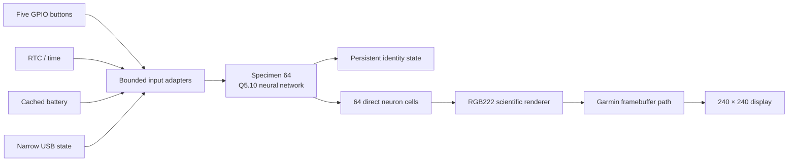

<div align="center">

# FLYWATCH / SPECIMEN 64

```text
                 \   |   /
              .---\--+--/---.
           .-'    o--o--o     '-.
         .'   o--o  / \  o--o    '.
        /   o/  o--o---o--o  \o    \
       ;   / o--o  FLY  o--o \     ;
       |  o--o  NEURAL FIELD  o--o  |
       ;   \ o--o  64  o--o  /     ;
        \   o\  o--o--o  /o       /
         '.   o--o  |  o--o      .'
           '-.____\_|_/_____.-'
                  /   \

           FORERUNNER 245 // ALIVE
```

**A fruit-fly-inspired neural organism living inside a Garmin Forerunner 245.**

`64 NEURONS` · `FIXED-POINT` · `PERSISTENT STATE` · `240 × 240` · `VERY EXPERIMENTAL`

</div>

---

## Source-equation comparison lab

The offline lab now includes a separate deterministic reference for the
published signed tanh rate equation, alongside unchanged fixed-point CX60.
Compare cue loss, shifts and P-EN drive with independent time/activity axes,
signed activity maps, explicit directional drift and reproducible exports.
Noise and the source spike-input preprocessing are deliberately omitted.
See [the reference contract](flyos/sim/RATE_REFERENCE.md) for equations,
provenance, numerical checks and limits. This does not change any target gate.

## What is this?

FlyWatch is an attempt to turn a Garmin Forerunner 245 into a strange little
scientific instrument—part watch face, part neural observatory, part persistent
artificial organism.

The last reported watch experiment ran **Specimen 64**, a deterministic 64-neuron network with
sparse weighted connections. Every simulated neuron maps directly to a cell in
the display. The colors and pulses are state, not decorative random noise.

This is firmware reverse engineering, not a Connect IQ app.

> [!IMPORTANT]
> The current result is a **GarminOS-resident executable overlay**. It is not yet
> a replacement bootloader or standalone operating system. Arbitrary boot has not
> been demonstrated, and recovery still depends on GarminOS and USB continuing to work.

## Specimen status

| Channel | Reading |
|---|---|
| Host organism | Garmin Forerunner 245, non-Music, HWID 3076 |
| Last documented installed experiment | Synthetic 13.76 over official 13.70; user-observed, no flash readback |
| Neural population | 64 deterministic fixed-point neurons |
| Neuron-to-screen mapping | 1 simulated neuron → 1 rendered cell |
| Live inputs | Five buttons, RTC, cached battery percentage, narrow USB state |
| Unbound inputs | Heart rate, motion, ambient light, charging telemetry |
| Persistence | Designed and host-tested; live identity persistence is still limited |
| Boot independence | Not demonstrated |
| Feasibility verdict | **YELLOW — alive inside GarminOS, not free of it** |

## The current instrument

```text
┌──────────────────────────────┐
│ 14:52              B 73%     │
│                              │
│       /\  SPECIMEN  /\       │
│      /  \    64    /  \      │
│     │ ·─●─·──●──·─● │        │
│     │ ●╲·╱●  ·  ●╲· │        │
│     │ ·─●──●──●─·   │        │
│     │ ●╱·╲●  ·  ●╱· │        │
│      \__NEURAL FIELD_/       │
│                              │
│ STATE  QUIET / RESPONSIVE    │
│ AGE    03:14:22              │
└──────────────────────────────┘
```

The live display uses the watch's RGB222 framebuffer palette:

- **Green** — excitatory activity
- **Magenta** — inhibitory activity
- **Amber** — saturated activity
- **Gray** — anatomical scaffold
- **Black** — background

The interface deliberately looks like a lab readout rather than a cartoon
smartwatch. The display renderer and network model are reproducible on the host
before they are compiled into the constrained target overlay.

## Current controls and open work

The last user-observed installed build is synthetic 13.76. It filters START,
DOWN, and UP on a stable HOME view; LIGHT and BACK remain native. The watch
has not supplied an internal-flash readback, so its present state is unverified.
See the [installed-overlay diagnosis](docs/installed-overlay-ux-diagnosis.md).

| Physical control | Instrument label | Intended neural effect | Ownership policy |
|---|---|---|---|
| Top-left | `LIGHT>LUX` | Light stimulus placeholder | Passes to Garmin so the backlight remains available |
| Middle-left | `UP>PULSE` | Raise arousal | Captured only on the stable FlyOS home view |
| Bottom-left | `DOWN>CALM` | Lower arousal | Captured only on the stable FlyOS home view |
| Top-right | `START>BURST` | Inject a strong neural burst | Captured on FlyOS; native on system/update views |
| Bottom-right | `BACK>SYSTEM` | System escape | Always passes to GarminOS |

The documented source already latches START/DOWN/UP ownership at press;
LIGHT/BACK stay native. Exclusive storage, complete sequence behavior on the
watch, and a safe redraw retry callback remain unproved. The user also observed
a return to FlyOS more than ten seconds after USB removal. The quarantined 13.80 experiment does not fix that
delay and weakens LIGHT handling; its [live-use decision remains NO-GO](docs/fivekey-1380-offline-candidate.md).

The new host-only interaction lab makes the intended conservative policy
executable: one owner for each complete sequence, native LIGHT/BACK, and
bounded redraw attempts that remain pending until acknowledged. These tests
do not establish target RAM ownership, callback safety, or device timing.

The [watch-readiness fault guide](docs/watch-redraw-readiness.md) now separates
initial key pass-through, queue rejection, accepted-but-undisplayed requests,
and actual visible recovery. It includes six executable host fault traces,
bounded button-redraw regression tests, and an ordinary-use observation
checklist. These test a proposed controller; they do not change the installed
watch or fix its USB-return delay.

## Signal path



No floating point is required in the target neural step. The model is small,
sparse, deterministic, and designed to evolve continuously on watch-scale power
and memory budgets.

## What lives in this repository

```text
flyos/
├── fly/          neural models and persistence
├── display/      framebuffer and neural renderers
├── input/        host input adapters
├── kernel/       host runtime
├── sim/          host-only interaction policy and replay traces
├── target/       Cortex-M4 and FR245 overlay targets
└── tests/        deterministic model and renderer tests

tools/
├── garmin-firmware/   GCD inspection, emulation, validation, and packaging
├── device-backup/     read-only backup tooling
└── live-proof/        guarded update staging

docs/                  hardware, firmware, boot, recovery, and experiment evidence
```

Private watch files, activity and GPS history, unique identifiers, official Garmin
firmware, modified update images, Ghidra databases, and generated target binaries
are intentionally excluded from Git.

## Build the organism on a host

```powershell
cmake -S flyos -B flyos/build
cmake --build flyos/build
ctest --test-dir flyos/build --output-on-failure
```

The host suite exercises the neural model, persistence format, display renderer,
color roles, preview export, complete key-sequence ownership, redraw policy,
and deterministic behavior. Target builds require a
local ARM toolchain plus byte-pinned firmware evidence that is not distributed here.

## Explore the offline circuit observatory

The lab opens a published-topology circuit explorer: 60 representative model
populations and all 326 directed connections from the Drosophila heading model
of [Pisokas, Heinze and Webb (eLife 2020)](https://doi.org/10.7554/eLife.53985).
Move a synthetic landmark, inject a P-EN A/B drive, remove the cue, and inspect
any unit or pathway. Source strengths and implemented coefficients are visible
separately. The larger SVG is a schematic, not anatomical geometry.

The topology is anatomy-constrained research-model data, not an EM-derived
individual-neuron connectome. Our bounded fixed-point rate dynamics are an
explicit simplification, not a replication of the paper's spiking simulator.
See [the complete provenance, equations and limitations](flyos/sim/CX60.md).

The original hand-authored Brain64 remains selectable, with held-key controls,
motor bursts, synthetic watch sensors and deterministic seeds. Nine policy
replays remain available. Every activation and framebuffer pixel comes from C;
the page needs no server or network.

The **Measured anatomy** lens adds a separate static view of 56 identified
hemibrain cells: 46 EPG and 10 ER4m. Inspect 762 supplied directed cross-class
pairs containing 16,774 ellipsoid-body synapses, search exact body IDs, compare
reciprocal counts, and filter or export the supplied projection. These are
measured counts from the [Hulse et al. analysis (eLife 2021)](https://doi.org/10.7554/eLife.66039),
with CC BY 4.0 attribution. The ring arrangement is a schematic. Counts do not
specify neural signs or efficacy, and unprovided pairs are not evidence of
absence. This fragment has no simulated activity and is not a whole brain.
See [data provenance and limitations](flyos/sim/data/hulse2021/README.md).

Choose **Paired experiments** to compare two identically initialized CX60
instances. Shift the cue, remove and restore it, or add synthetic P-EN A/B
drive while an untouched control runs alongside. Inspect aligned activity
profiles and trajectories, scrub the intervention/recovery phases, and export
the exact commands. These experiments expose the current adaptation's limits:
cue loss with zero P-EN drive decays to silence, while drive can alter activity
without moving the coarse strongest-sector readout. See the
[protocols, measurements and published-model comparison](flyos/sim/EXPERIMENTS.md).

After the host build, generate a replay-only bundle:

```sh
python flyos/tools/build_interaction_lab.py --exporter flyos/build/flyos-interaction-exporter --output flyos/build/interaction-lab
```

On Windows, use the built executable's `.exe` path (for multi-configuration
CMake generators it may be under `flyos/build/Debug/`). Open the generated
`index.html` in a browser. Choose one of nine scenarios, scrub or play its
frames, inspect any of the 64 neurons, and export the selected trace.
No server, network connection, proprietary input, or watch is needed. The
output directory must be new; existing captures are never overwritten.

To include the live engine, install the compiler in an isolated environment
and build the small, import-free WebAssembly module:

```sh
python -m venv /tmp/flywatchos-tools
/tmp/flywatchos-tools/bin/python -m pip install ziglang==0.14.1
/tmp/flywatchos-tools/bin/python flyos/tools/build_live_wasm.py
python flyos/tools/build_interaction_lab.py --exporter flyos/build/flyos-interaction-exporter --wasm flyos/build/flyos-live.wasm --output flyos/build/live-lab
```

Use the matching `Scripts/python.exe` path on Windows. Node is required for
build validation. Compiler installation needs registry access; the emitted
page is entirely offline. Its live engine is 13,890 bytes in the tested build,
imports nothing, and has a fixed 128 KiB memory limit. Replay mode still works
when WebAssembly is unavailable. The live view selector is a supplied fixture,
not a native view reader. See [test and build instructions](flyos/tests/README.md).

The HOME images and neural telemetry come from the real portable C model and
renderer. Native Garmin screens are deliberately not simulated. Inputs,
callback eligibility, queue acceptance, and display acknowledgments are
explicit host fixtures. This is a host simulation and policy lab, not a watch emulator,
firmware candidate, proof of hardware safety, or solution to the live USB delay.
See [host policy semantics](flyos/sim/README.md) and
[public versus private test coverage](tools/garmin-firmware/tests/README.md).

The [public offline workflow](.github/workflows/offline-checks.yml) runs the
same [pinned aggregate checks](ci/README.md) on GitHub: C tests, source-data
integrity, native/Wasm parity, DOM state checks and public firmware-tool tests.
It has read-only repository permissions and does not acquire private evidence
or build firmware. Actual browser layout and device interaction still require
separate validation.

## Evolution log

- [x] Inventory the FR245 USB and firmware surface
- [x] Preserve and hash all locally accessible evidence
- [x] Parse Garmin GCD update containers reproducibly
- [x] Demonstrate visible modified resources on the live watch
- [x] Execute bounded custom ARM code inside the Garmin application
- [x] Render a full-screen interactive neural display
- [x] Expand from 32 to 64 directly mapped neurons
- [x] Verify guarded home-view button ownership offline
- [x] Make every neural button effect visible and legible offline
- [x] Record user-observed 13.76 installation and its limitations
- [x] Add host-only input ownership and redraw regression lab
- [x] Run the real C network interactively in an offline WebAssembly sandbox
- [x] Exercise bounded synthetic view snapshots and their ABA limitation
- [x] Add published CX60 topology, inspectable connections and a circuit observatory
- [x] Inspect measured ER4m↔EPG body IDs and directed EB synapse counts
- [x] Add pinned public-only checks with read-only GitHub Actions permissions
- [x] Compare reproducible CX60 cue/drive interventions against identical-start controls
- [ ] Prove target storage ownership and safe redraw context
- [ ] Verify complete sequence ownership on hardware
- [ ] Bind safe heart-rate, motion, and charging observations
- [ ] Strengthen persistent identity across restarts
- [ ] Establish a dependable nonboot recovery path
- [ ] Demonstrate standalone custom boot—or document why it is impractical

## Evidence before mythology

This project does not claim secure-boot bypass, arbitrary firmware execution, or
standalone FlyOS without evidence. The current boundary is documented in the
[session report](docs/session-report.md), [boot-chain analysis](docs/boot-chain.md),
[N64 design](docs/superpowers/specs/2026-09-14-flyos-neural-specimen-n64-design.md),
and [recovery analysis](docs/recovery.md).

Firmware experiments can permanently brick the watch. Review the exact image,
write ranges, recovery assumptions, and hashes before staging anything to hardware.
The guarded staging tool defaults to a dry run and does not include firmware images.

---

<div align="center">

`FLY LIVES // OBSERVE CAREFULLY`

Garmin and Forerunner are trademarks of Garmin Ltd. This project is unaffiliated
with and unsupported by Garmin.

</div>
